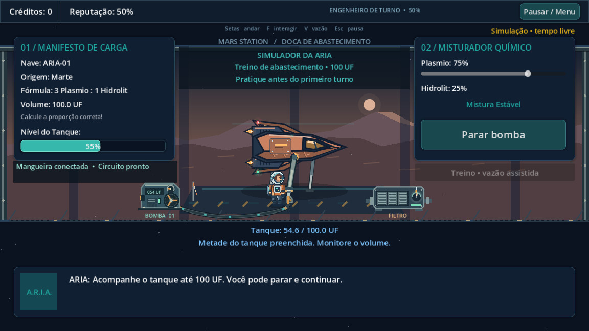

# Fueling Frontiers: Mars Station

Uma nave pousa em Marte e pede 100 unidades de combustível, com três partes do componente A para uma do componente B. Na doca, você precisa conectar a mangueira, regular a mistura e decidir quando desligar a bomba. Em **Fueling Frontiers: Mars Station**, a matemática faz parte da operação de uma estação de abastecimento espacial.

## História e objetivo

Zorome herda o posto da família em Marte junto com as dívidas da estação. A corporação HydroCore Inc. quer comprá-lo. A reputação do posto depende dos pilotos que passam pela doca e precisam de combustível para seguir viagem.

Você escolhe **Lia, Davi ou Íris** para operar a doca. A assistente **ARIA** orienta o primeiro abastecimento. Depois do treino, cada turno traz seis contratos. O objetivo do primeiro turno é aprovar pelo menos três atendimentos. Cumprir os pedidos rende créditos para investir na oficina. Erros de mistura, volume ou prazo afetam o resultado e a reputação da estação.

| Ficha do jogo | Detalhes |
| --- | --- |
| Gênero | Simulação e gerenciamento em 2D, para um jogador |
| Público-alvo | Estudantes de 10 a 18 anos e pessoas que gostam de desafios de lógica e precisão |
| Tecnologia | Godot 4.6.1 e GDScript · versão 0.13.0 |
| Plataforma e idioma | Computador, com teclado e mouse · português do Brasil |

## Como executar

1. Instale a **Godot 4.6.1**, edição padrão. [Download da Godot](https://godotengine.org/download/archive/4.6.1-stable/)
2. Na página deste repositório, escolha **Code → Download ZIP** e extraia a pasta inteira. Se preferir usar Git, execute `git clone https://github.com/julio06rosa/fueling-frontiers-godot.git`.
3. No gerenciador de projetos da Godot, clique em **Importar**, selecione `project.godot` e abra o projeto. Pressione **F5** para iniciar pelo menu principal.

No Windows, com a Godot instalada, também é possível abrir [Jogar_no_Windows.cmd](Jogar_no_Windows.cmd) na pasta extraída. O atalho procura a Godot 4.6.1 em Downloads ou um executável da Godot disponível no PATH.

## Sua primeira partida

1. Escolha um personagem no menu. **Como jogar** abre o guia de controles. **Treinar com a ARIA** inicia um atendimento sem limite de tempo.
2. Leia o manifesto da ARIA-01. São **100 UF** (unidades de combustível) na proporção **3:1**. Das quatro partes da mistura, três são do componente A. Isso corresponde a **75% de A e 25% de B**.
3. Caminhe até a bomba à esquerda e pressione **F** para pegar o bico. Passe pela frente da bomba, leve a mangueira até o bocal sob a nave e pressione **F** novamente para travar o encaixe.
4. Ajuste o misturador para **75% de A**. Pressione **Espaço** para ligar a bomba, acompanhe o volume no tanque e pressione **Espaço** outra vez ao chegar à meta. Ao concluir o treino, o primeiro cargueiro entra na doca com um novo manifesto e um prazo.

## Decisões durante o turno

| Situação | O que o jogador faz |
| --- | --- |
| Abastecimento | Interpreta a proporção do manifesto, regula a mistura e alterna para a vazão fina perto do volume solicitado. |
| Tempestade de poeira | Fecha a comporta e faz a nave aguardar, ou libera o pouso. Com a doca aberta, a poeira suja o filtro e reduz a vazão. A limpeza é feita grade por grade. |
| Reposição de óleo | Quando a luz da escotilha indica manutenção, compara o nível do visor com a marca de serviço. Se há 0,75 L e a meta é 1,50 L, a dose necessária é de 750 mL. |
| Troca do anel | Retira o anel rompido, lê as duas extremidades do sulco na régua e escolhe o diâmetro pela diferença. Um encaixe entre 5 mm e 25 mm pede um anel de 20 mm. |
| Fim do turno | Consulta o relatório de aprovações, créditos e reputação. Na oficina, pode investir em vazão, válvula automática ou sensor de mistura. O progresso é salvo localmente. |

### Controles

| Comando | Ação |
| --- | --- |
| Setas | Movimentar o personagem |
| **F** | Interagir com o equipamento próximo, a mangueira ou a escotilha |
| **Q / E** | Reduzir ou aumentar a porcentagem de A. Segure **Shift** para ajustar de cinco em cinco pontos percentuais. |
| **Espaço** | Ligar ou desligar a bomba |
| **V** | Alternar entre vazão rápida e fina durante os contratos |
| **1 / 2** | No alerta de tempestade, fechar a doca ou liberar o pouso |
| **Esc** | Pausar o turno ou sair de uma inspeção |

## Melhorias observadas nos testes de jogabilidade

Nos testes internos, a mensagem de filtro sujo aparecia, mas o equipamento continuava com a mesma aparência. Agora a poeira se acumula nas grades e cada passada da escova mostra o que foi limpo. A frente de poeira agora aparece no horizonte, a comporta cobre o vão da doca e o som do vento muda quando ela fecha. O radar apresenta essa decisão no segundo atendimento do turno.

Nos primeiros reparos, era difícil entender por que a nave precisava de óleo ou de outro anel. O visor do reservatório e a régua do encaixe passaram a mostrar o problema antes da escolha. Depois da intervenção, o jogador pode conferir o nível ou a vedação e entender por que a medida funcionou.

## Equipe e documentação

Projeto desenvolvido por **Júlio César Duarte da Rosa**, **Rafael da Rocha da Silva** e **Paulo Guilherme Richeski Padilha**, no curso de Engenharia de Software da Católica de Santa Catarina, para a disciplina **Projeto de Aprendizagem Colaborativa Extensionista IV**.

- [Guia de controles, manutenção e missões](LEIA-ME.txt)
- [Documento de design do jogo · versão 0.9.3](docs/GDD.md)
- [Checklist de validação](docs/CHECKLIST_VALIDACAO.md)
- [Histórico de desenvolvimento](docs/CHANGELOG_PROFISSIONAL.md)
